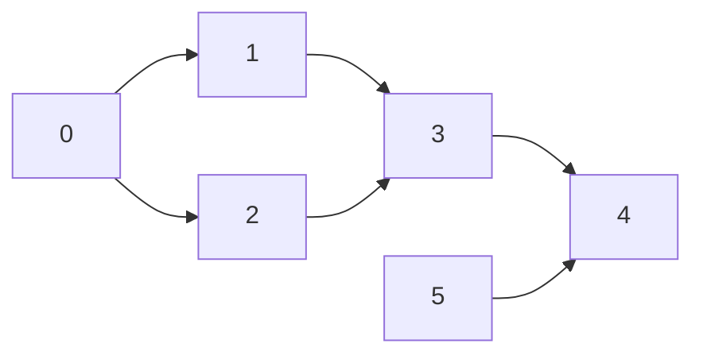

# Topological Sort

## Trigger
Tasks with dependencies ("to take course 1 you must finish course 0"), and you need an order that respects every dependency, or you need to prove no such order exists because the dependencies form a cycle. The graph is directed.

## How it works
Kahn's algorithm counts each node's **in-degree**: how many prerequisites it still waits on. Start with every node whose in-degree is 0. Take one, add it to the order, and remove its outgoing edges, which lowers its neighbours' in-degrees; any neighbour that reaches 0 is now ready. If the order ends with fewer nodes than the graph has, the leftover nodes sit on a cycle.

## Diagram
Six tasks. An arrow `a → b` means `a` must come before `b`:



## Template (Kahn's algorithm)
```
indegree = count incoming edges for every node
queue = [n for n in nodes if indegree[n] == 0]
order = []
while queue:
    u = queue.pop_front()
    order.append(u)
    for v in graph[u]:
        indegree[v] -= 1
        if indegree[v] == 0:
            queue.append(v)
if len(order) < len(nodes):
    return "cycle"                 # no valid order
```

## Worked example
Kahn's algorithm on the graph above. In-degrees at the start: 0→0, 1→1, 2→1, 3→2, 4→2, 5→0.

| take | in-degrees that hit 0 | queue after | order so far |
|:---:|:---|:---:|:---|
| | start: 0 and 5 | `0 5` | |
| 0 | 1, 2 | `5 1 2` | `0` |
| 5 | (4 drops to 1) | `1 2` | `0 5` |
| 1 | (3 drops to 1) | `2` | `0 5 1` |
| 2 | 3 | `3` | `0 5 1 2` |
| 3 | 4 | `4` | `0 5 1 2 3` |
| 4 | | | `0 5 1 2 3 4` |

All 6 nodes made it into the order, so there is no cycle. Node 3 waits until both 1 and 2 are done, and node 4 until both 3 and 5 are. Many valid orders exist; this is one.

## Classic problems
- Course Schedule (LC 207)
- Course Schedule II (LC 210)
- Alien Dictionary (LC 269)
- Minimum Height Trees (LC 310)
- Parallel Courses (LC 1136)

## Complexity
Time O(V + E): every node enters the queue once and every edge is removed once. Space O(V + E) for the adjacency list and in-degrees.

## Common mistakes
- **Reversed edge direction.** `[1, 0]` in Course Schedule means "0 before 1". Build `0 → 1`, not the other way around.
- **Not checking the final count.** A cycle does not crash Kahn's algorithm; it just leaves nodes out. Compare `len(order)` with the node count.
- **Forgetting isolated nodes.** Nodes with no edges have in-degree 0 and must start in the queue.
- **DFS version without three states.** The DFS approach needs "visiting" and "done" to tell a cycle from a node reached twice.

## vs BFS and DFS
Kahn's algorithm is [BFS](bfs.md) where a node becomes ready only when its in-degree reaches 0, not as soon as it is discovered. The DFS version is post-order [DFS](dfs.md): each node is added after all its descendants, and the reversed list is a valid order.

## See it run
Watch in-degrees count down and tasks unlock the moment their last prerequisite finishes: ▶ https://tryexpora.com/algorithm-debugger

Go deeper: [BFS, DFS or Dijkstra? How to pick in an interview](https://tryexpora.com/blog/graph-algorithms-coding-interview)
